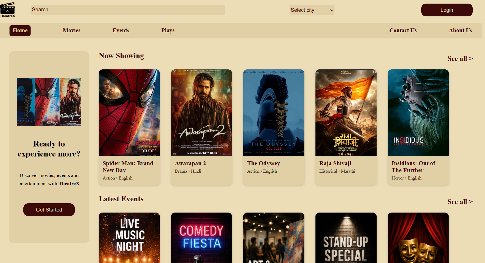
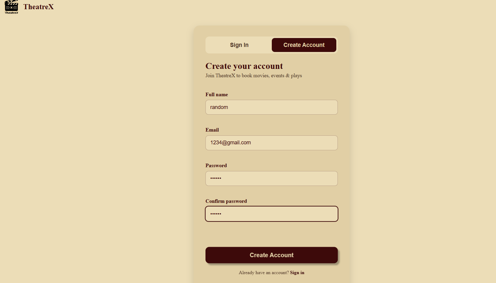
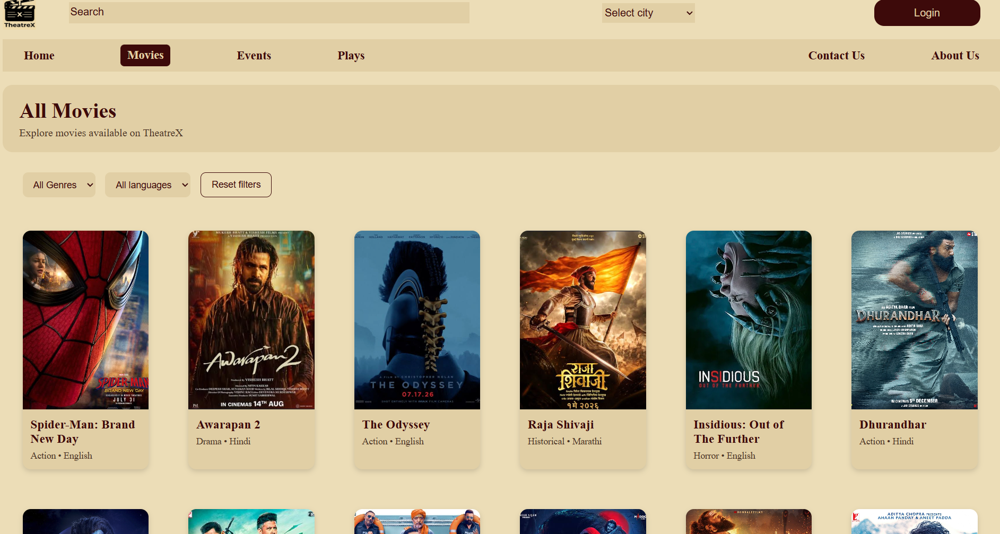
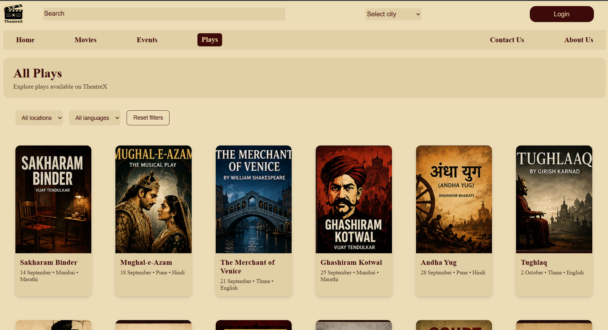
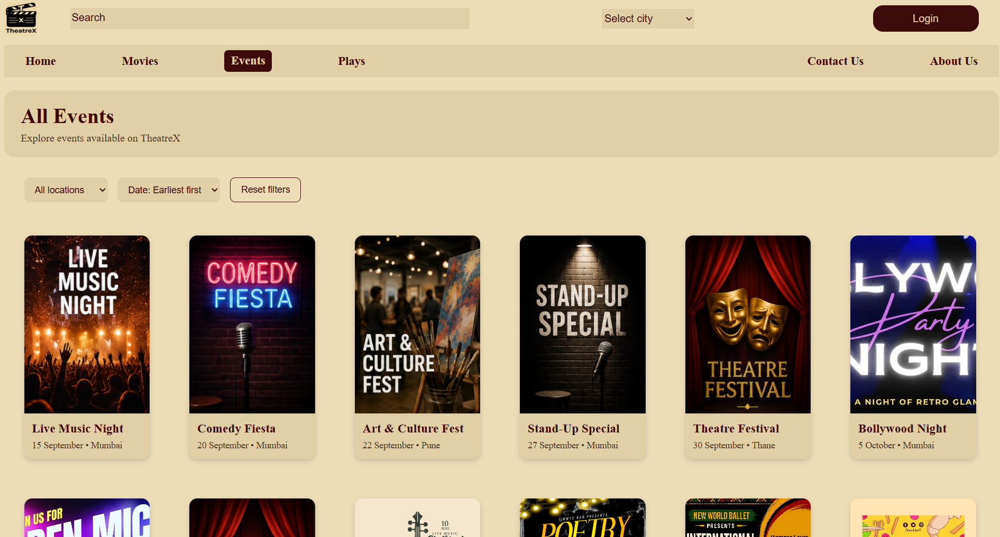
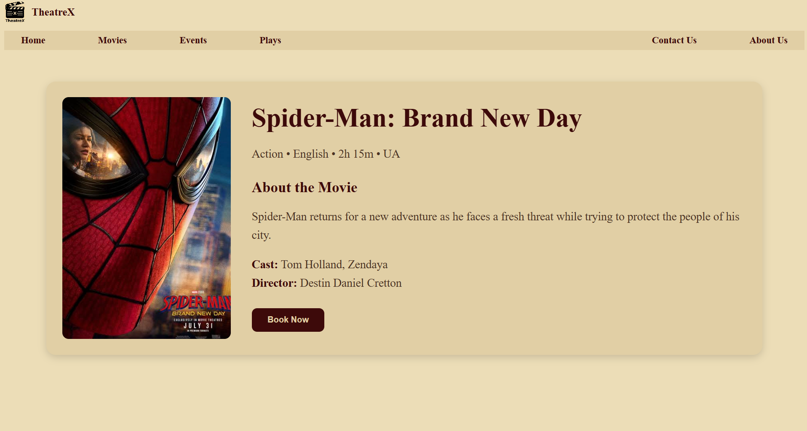
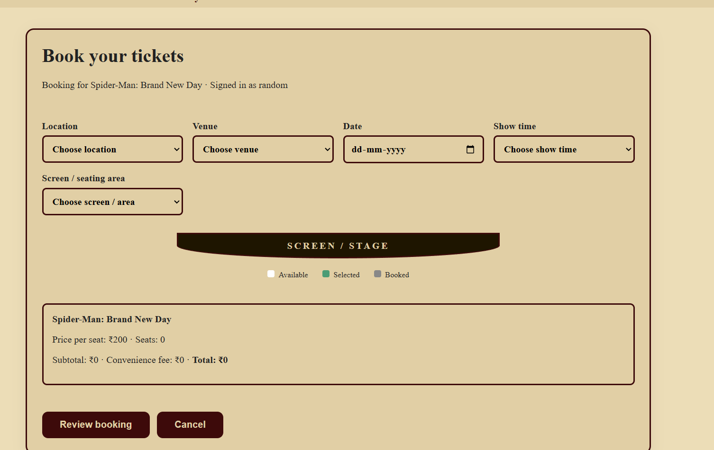
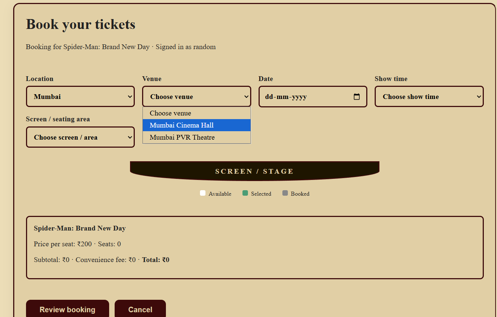
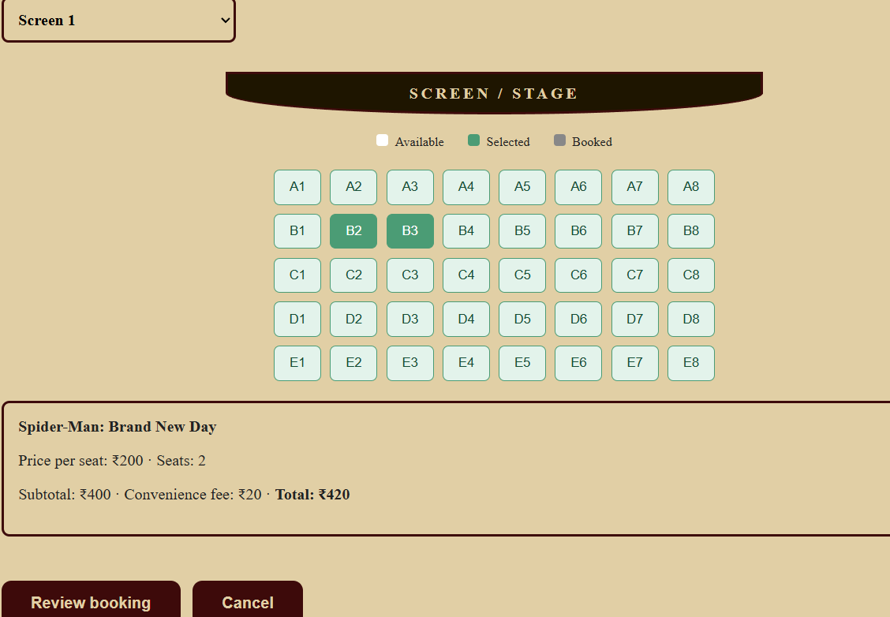
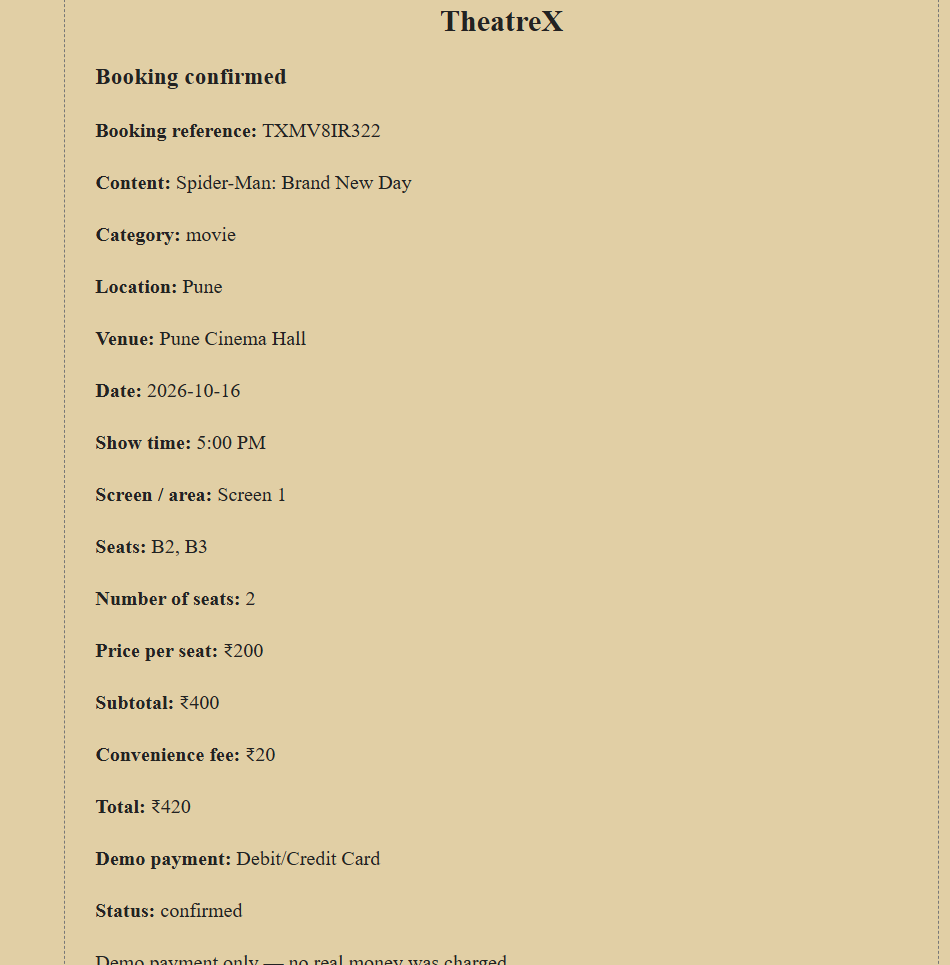

# TheatreX — Movie, Event and Play Booking Website

## Project Overview

TheatreX is a front-end web mini-project for browsing movies, live events and theatre plays, viewing item details, creating an account or signing in, and completing a simulated ticket-booking flow. The interface is built with HTML, CSS and vanilla JavaScript.

**Project type:** Group mini-project  


## My contributions :

- **UI/UX Design**: Made key design decisions across the website, including page layouts, color palettes, icon colors, visual consistency, and overall styling.
  
- **Logo Design**: Contributed to the logo creation and final design decisions.
  
- **Homepage Development**: Designed and developed the homepage, including its layout, content presentation, and interactive elements.
  
- **Movie Discovery**: Implemented movie filtering and search functionality to help users find movies easily.
  
- **Booking System**: Designed and implemented the booking flow, including the logic for selecting locations, theatres, dates, screens, and seats.
  
- **Reusable Data Structures**: Established the initial data structures and object-based approach used to represent and display movies, events, and locations across the website.

Beyond implementation, I took the initiative in planning the UI and defining the underlying logic for key features before applying those decisions consistently throughout the project.

## Features

- **Home page:** Entry point for exploring the TheatreX catalogue.
- **Movies, events and plays:** Separate catalogue pages populated from JavaScript data.
- **Search and filters:** Search catalogue content and use the available category-specific filters, such as genre, language, location or event sorting.
- **Details pages:** Open individual movie, event or play details from catalogue cards.
- **Account flow:** Sign in and create an account through the front-end forms.
- **Login-aware booking:** Booking actions prompt users to sign in when needed and can return them to the pending booking flow.
- **Seat selection:** Choose a show option and available seats; already-confirmed seats for the same option are marked unavailable in the browser's stored booking data.
- **Booking summary and confirmation:** Review the selection, choose a demo payment method, and see a booking confirmation/reference.
- **Booking cost calculation:** The current demo uses a category-based seat price and a convenience fee.
- **About and contact pages:** Informational pages for the project.
- **Responsive viewport support:** Pages include viewport metadata and CSS-based layouts.

## Technology Stack

- **HTML5** — page structure and forms
- **CSS3** — styling and layout
- **JavaScript (vanilla)** — catalogue rendering, search/filter logic, account state and booking interactions
- **Browser `localStorage`** — demo account/session and booking persistence

No front-end framework, package manager, build step or server-side application is included in the supplied project.

## Project Structure

The main application files are in the `theatreX/` directory:

```text
theatreX/
├── home.html
├── home.css
├── home.js
├── movies.html
├── events.html
├── plays.html
├── movieDetails.html
├── eventDetails.html
├── playDetails.html
├── login.html
├── login.css
├── auth.js
├── booking.html
├── booking.css
├── booking.js
├── booking-auth.js
├── about-us.html
├── contact-us.html
├── support.css
└── images/
    └── catalogue artwork and site images
```

### Main files and responsibilities

| File | Purpose |
|---|---|
| `home.html` | Main landing page |
| `home.css` | Shared site styling and catalogue layouts |
| `home.js` | Movie, event and play data; catalogue cards; search and filter logic |
| `movies.html`, `events.html`, `plays.html` | Full catalogue pages |
| `movieDetails.html`, `eventDetails.html`, `playDetails.html` | Individual item detail views |
| `login.html`, `login.css` | Sign-in and account-creation interface |
| `auth.js` | Browser-based account/session handling, account controls and login continuation |
| `booking-auth.js` | Checks whether a user is signed in before starting a booking |
| `booking.html`, `booking.css` | Ticket-booking interface and its styling |
| `booking.js` | Show options, seat selection, pricing, booking review, demo payment choice and confirmation |
| `about-us.html` | About page |
| `contact-us.html` | Contact page |
| `support.css` | Additional styling for the About and Contact pages |
| `images/` | Images used by the site and catalogue |

## Application Architecture

The project uses a simple **client-side, multi-page architecture**:

1. **HTML pages** provide the page structure and connect the relevant stylesheets and scripts.
2. **CSS files** style the pages. `home.css` supplies much of the shared visual design, while login, booking and support pages have additional stylesheets.
3. **`home.js`** holds the movie, event and play catalogue data and renders cards into the relevant pages. It also handles search and available filters.
4. **Detail scripts** read an item identifier from the URL and display the matching catalogue entry or its additional details.
5. **`auth.js`** manages account creation, sign-in, current-session state and account UI using browser storage.
6. **`booking-auth.js`** directs unauthenticated users to sign in before they continue to booking.
7. **`booking.js`** manages booking options, seat selection, pricing, review, demo payment selection and confirmation. Booking data is stored in browser `localStorage`.

There is **no backend API or database** in this version. The browser is responsible for storing the demo account, session and booking data.

## Screenshots

This section showcases the main pages and booking workflow of TheatreX, including its home page, authentication interface, content browsing pages, movie details, booking process, and printable booking summary.

### 1. Home Page

The home page serves as the main entry point to TheatreX, providing navigation to the website's main sections and access to the available movie, play, and event listings.



### 2. Login Page

The login page provides the user interface for account access within the TheatreX application.



### 3. Movies Page

The movies page displays the available movie listings, allowing users to explore titles and proceed to the corresponding movie details page.



### 4. Plays Page

The plays page presents the theatrical performances listed on TheatreX, giving users a dedicated section to browse available plays.



### 5. Events Page

The events page provides a dedicated interface for exploring the events listed on the website.



### 6. Movie Details Page

The movie details page presents information about a selected movie and provides access to the movie booking process.



### 7. Movie Booking Flow

The following screenshots demonstrate the booking workflow for one selected movie.

#### 7.1. Booking Interface

This screen shows the initial stage of the selected movie's booking process.



#### 7.2. Booking Details

This screen shows the subsequent booking stage, allowing users to choose the location,theatre,screen etc.



#### 7.3. Seat Selection

This screen demonstrates the seating selection interface, where users can view the available seating arrangement and make their selections.




### 8. Bill and Print Page

The bill page displays the booking summary in a printable format. Users can review the displayed details and use the browser's print functionality to print the page or save it as a PDF.



## Core Functionalities and Implementation

### 1. User Authentication and Password Handling
- Implements account creation and login using JavaScript.
- Manages user session state and account-related information through browser `localStorage`.
- Connects authentication with the booking workflow so users can sign in before proceeding when required.

### 2. Persistent Data Storage
- Uses browser `localStorage` to retain account, session and booking information.
- Uses `JSON.stringify()` and `JSON.parse()` to store and retrieve structured JavaScript data.
- Maintains booking information across page navigation and browser refreshes.

### 3. Dynamic Catalogue Rendering
- Uses JavaScript to display movie, play and event listings.
- Supports search and filtering through the available catalogue controls.
- Connects selected catalogue items to their corresponding details pages.

### 4. Location, Venue and Show Selection
- Provides location-based venue selection.
- Updates the available venue options according to the selected location.
- Allows users to choose show dates, timings and the relevant screen or seating area.

### 5. Interactive Seat Selection
- Displays a seating arrangement with selectable seats.
- Tracks the seats selected by the user.
- Uses stored booking information to determine seat availability for the selected show and booking configuration.
- Updates the booking information when the user changes their selections.

### 6. Dynamic Pricing and Booking Summary
- Calculates the ticket subtotal based on the selected seats and applicable seat prices.
- Includes the applicable convenience fee in the total calculation.
- Displays the selected entertainment item, venue, show details, seats and total cost for review.

### 7. Payment Processing Simulation
- Provides demo payment methods as part of the booking workflow.
- Records the selected demo payment method with the booking information.
- Completes the simulated payment and booking confirmation flow without processing a real financial transaction.

### 8. Booking Confirmation and Bill Generation
- Generates a booking reference for the confirmed booking.
- Saves the booking details in browser storage.
- Displays the confirmed booking information on the bill page.
- Supports printing the booking summary or saving it as a PDF through the browser's print functionality.

### 9. Interactive User Interface
- Uses HTML for page structure, CSS for presentation and JavaScript for interactive behaviour.
- Uses DOM manipulation and event listeners to respond to user actions.
- Maintains a consistent interface across catalogue, authentication and booking pages.

## How to Run the Project

### Option 1: Open the HTML file

1. Download or clone this repository.
2. Open the `theatreX` folder.
3. Open `home.html` in a modern browser.

### Option 2: Run with Visual Studio Code

1. Install [Visual Studio Code](https://code.visualstudio.com/).
2. Open the project folder containing `home.html`.
3. Open `home.html`.
4. Run it using the **Live Server** extension, if installed, or open the file in a browser.

This is a static front-end project, so no `npm install`, compilation or build command is required. If a browser behaves differently when opening files directly, use Live Server.

## How to Use the Website

1. Open the home page.
2. Browse the Movies, Events or Plays section.
3. Use the search box and available filters to narrow the catalogue.
4. Select a catalogue item to open its details.
5. Choose the booking action. If not signed in, follow the sign-in/account-creation flow.
6. In the booking page, select the available show options and seating area, then choose seats.
7. Review the booking summary.
8. Select one of the available **demo** payment methods to complete the simulated booking and display the confirmation.

The exact options available depend on the catalogue data and booking interface included in the project.

## Data Storage and Important Limitations

- Account, session and booking information is stored in the browser's `localStorage`.
- Data is local to the browser profile and origin. It is not shared with a real server or automatically synchronized across devices.
- Clearing browser storage can remove saved demo accounts, sessions and bookings.
- Authentication is a prototype implementation, **not production-grade authentication**. Do not use real passwords or sensitive personal information.
- Payment is simulated. The project does not process real payments or connect to a payment gateway.
- Booking availability is based on locally stored demo bookings. Without a server and shared database, it cannot guarantee seat availability across different devices or browser profiles.
- Catalogue content and prices are sample/demo data defined in the JavaScript files and should be checked before any real-world use.

## Future Improvements

Possible extensions include a backend API and database, secure server-side authentication, shared seat inventory, real payment-gateway integration, stronger input validation, automated tests and deployment to a hosting platform.

## Academic Use and Acknowledgement

TheatreX was developed as a group mini-project. This repository is maintained by me.
